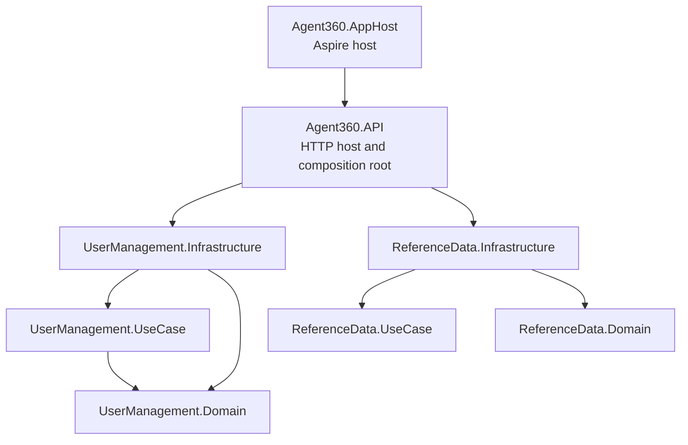

# Current Project Structure

This document describes the current `Agent360` repository. It is documentation only.

> The repository currently targets `net10.0` through `Directory.Build.props`.

## Architecture



Dependency direction:

- the API host references module infrastructure projects;
- infrastructure references use-case and domain projects;
- use-case projects reference domain projects and shared contracts;
- domain projects do not reference infrastructure or the API host;
- shared primitives come from `Hmz.Core.SharedKernel`.

## Root files

| Path | Purpose |
|---|---|
| `Agent360.slnx` | Main solution and test projects. |
| `global.json` | .NET SDK and Microsoft.Testing.Platform selection. |
| `dotnet-tools.json` | Repository-local `dotnet-ef` tool manifest. |
| `Directory.Build.props` | Common target framework, nullable, analyzer, and compiler settings. |
| `Directory.Packages.props` | Central package versions, including `Hmz.Core.SharedKernel`. |
| `docs/ADVANCED_SEARCH_GUIDE.md` | Shared list-query contract and implementation guide. |
| `docs/TESTING_AND_SHARED_KERNEL_GUIDE.md` | Testing and shared-kernel ownership guidance. |

## Projects

| Project | Responsibility |
|---|---|
| `src/Agent360.API` | Minimal API host, endpoint discovery, authentication, OpenAPI, middleware, and composition root. |
| `src/Agent360.AppHost` | Aspire orchestration for the API and PostgreSQL resources. |
| `src/Agent360.ServiceDefaults` | Health checks, telemetry, service discovery, and resilience defaults. |
| `src/Modules/ReferenceData/Agent360.ReferenceData.Domain` | Reference-data aggregates. |
| `src/Modules/ReferenceData/Agent360.ReferenceData.UseCase` | Reference-data use cases. |
| `src/Modules/ReferenceData/Agent360.ReferenceData.Infrastructure` | Reference-data EF Core persistence and seed data. |
| `src/Modules/UserManagement/Agent360.UserManagement.Domain` | User, Role, and Permission aggregates, value objects, events, specifications, and domain errors. |
| `src/Modules/UserManagement/Agent360.UserManagement.UseCase` | Commands, queries, handlers, responses, and application abstractions. |
| `src/Modules/UserManagement/Agent360.UserManagement.Infrastructure` | User-management EF Core persistence, identity lookup, and query adapters. |

The host API owns presentation and endpoint discovery. The module keeps application
orchestration in `UseCase`; no dormant module API or Application project is included.

## API host

Path: `src/Agent360.API`

Important areas:

- `Features/ReferenceData/Languages/Get` exposes `GET /api/v1/reference-data/languages?activeOnly=true`.
- `Features/ReferenceData/Currencies/Get` exposes `GET /api/v1/reference-data/currencies?activeOnly=true`.
- Both endpoints intentionally require `activeOnly`, providing a simple contract for verifying missing-query-parameter Problem Details.
  `activeOnly=true` returns active rows only; `activeOnly=false` returns both active and inactive rows.
  The starter seed data is active-only, so both values currently produce the same seeded rows until an
  administrator or migration adds an inactive row.

| Area | Responsibility |
|---|---|
| `Program.cs` | Application startup, middleware pipeline, Development core/demo seed, and Staging/Production core seed. |
| `Abstractions/IEndpoint.cs` | Contract implemented by minimal API endpoint classes. |
| `Extensions/EndpointExtensions.cs` | Endpoint discovery and mapping. |
| `Configurations/AuthenticationConfiguration.cs` | JWT/OAuth authentication. |
| `Configurations/CorsConfiguration.cs` | Environment-aware CORS policy from `CorsOptions`. |
| `Configurations/ApplicationBootstrapper.cs` | Environment-aware seeding: `SeedDevelopmentAsync` seeds core/demo data; `SeedCoreAsync` seeds core data only. |
| `Configurations/DevelopmentExperienceConfiguration.cs` | Development seed plus Development/Staging Scalar and OpenAPI mapping. |
| `Configurations/OptionsConfiguration.cs` | Strongly typed Logto/CORS binding and `ValidateOnStart`. |
| `Configurations/OpenApi/*` | Versioned OpenAPI, security metadata, and advanced-search schema descriptions. |
| `Hmz.Core.SharedKernel.Http` | HTTP problem details, result mapping, ETags, and conditional request helpers. |
| `Features/Roles/*` | Role create/read/update/delete and advanced-search endpoints. |
| `Features/Permissions/List/*` | Lists the complete catalog with assigned roles for a permission-row matrix. |
| `Features/Permissions/GetRole/*` | Reads one role's assigned permission metadata. |
| `Features/Permissions/ReplaceRole/*` | Replaces role assignments with strong `If-Match`/ETag protection. |
| `Features/Users/*` | Current profile, advanced user/role search, ADMIN-only role replacement, and signed Logto webhook ingestion. |
| `Identity/CurrentUser.cs` | Request-scoped current-user implementation. |
| `Middlewares/UserResolutionMiddleware.cs` | Maps the external subject to a local user ID and populates the request-scoped permission snapshot before authorization. |

Role list querying is exposed as:

```http
POST /api/v1/roles/search
```

The endpoint accepts `AdvancedSearchRequest`, returns `PagedResponse<RoleResponse>`, and maps
`AdvancedSearchValidationException.Errors` to HTTP validation problem details.

User list querying applies the same contract:

```http
POST /api/v1/users/search
```

The user adapter executes its allow-listed search and page selection in
PostgreSQL, then hydrates role metadata for only that page. Both search
endpoints publish concrete examples and `x-hmz-advanced-search` metadata.

## UserManagement module

### Domain

Path: `src/Modules/UserManagement/Agent360.UserManagement.Domain`

Contains:

- `UserAggregate/User.cs` and user value objects;
- `RoleAggregate/Role.cs`;
- `PermissionAggregate/Permission.cs`;
- read-only (`*ReadOnlySpecification`) and mutation (`AsTracking`) specifications;
- domain events and handlers;
- aggregate-specific error catalogs and exceptions;
- Ardalis specifications used by command/query persistence.

The domain remains independent of EF Core provider behavior and HTTP concerns.

### UseCase

Path: `src/Modules/UserManagement/Agent360.UserManagement.UseCase`

| Area | Responsibility |
|---|---|
| `Roles/Commands/*` | Role command handlers and responses. |
| `Roles/Queries/GetById/*` | Single-role query. |
| `Roles/Queries/Search/*` | Advanced-search request handling and endpoint field configuration. |
| `Permissions/Queries/*` | Permission catalog and role-permission matrix queries. |
| `Permissions/Commands/*` | Role-permission replacement command. |
| `Users/Commands/*` | User write use cases, including Logto webhook provisioning. |
| `Users/Queries/Search/*` | Advanced user search handling and its explicit field allow list. |
| `Users/Queries/GetCurrentProfile/*` | Current-user profile query. |

Use cases use `Hmz.Core.SharedKernel.Messaging` contracts such as `ICommand`, `IQuery`, and their handlers.

### Infrastructure

Path: `src/Modules/UserManagement/Agent360.UserManagement.Infrastructure`

| Area | Responsibility |
|---|---|
| `DependencyInjection.cs` | Registers EF Core, repositories, interceptors, shared advanced search, and feature adapters. |
| `Identity/UserIdentityService.cs` | Resolves a local user ID from an external Logto subject and uses `HybridCache`. |
| `Authorization/PermissionSnapshotResolver.cs` | Unions permissions from every assigned role and caches a stamp-versioned snapshot with only user and role tags. |
| `Persistence/Configurations/PermissionConfiguration.cs` | Maps the application permission catalog and unique permission code. |
| `Persistence/Configurations/RolePermissionConfiguration.cs` | Maps role-to-permission assignments. |
| `Persistence/Seeds/PermissionSeeder.cs` | Seeds the catalog and grants every catalog permission to `ADMIN` and `SYSTEM`. |
| `Persistence/AppDbContext.cs` | UserManagement EF Core context. Default schema: `user_management`. |
| `Persistence/Queries/RoleAdvancedSearchQuery.cs` | Implements `IAdvancedSearchQuery<RoleResponse>` and executes the source-first search/projection pipeline. |
| `Persistence/Configurations/*` | EF Core mappings. |
| `Persistence/Seeds/*` | Idempotent core seed data (roles, permissions, system users). |
| `Persistence/Migrations/*` | Tool-generated EF Core PostgreSQL migrations. |

## ReferenceData module

The ReferenceData module follows the same Domain → UseCase → Infrastructure direction. Its infrastructure project
contains the EF Core context, entity configurations, migrations, seeders, read query services, and service registration.

| Area | Responsibility |
|---|---|
| `Domain/LanguageAggregate` | Language aggregate and active-state behavior. |
| `Domain/CurrencyAggregate` | Currency aggregate and active-state behavior. |
| `UseCase/Languages/Queries/Get` | Language query contract, handler, and response DTO. |
| `UseCase/Currencies/Queries/Get` | Currency query contract, handler, and response DTO. |
| `Infrastructure/Persistence/Queries` | Read-only EF Core projections with the `activeOnly` predicate. |
| `Infrastructure/Persistence/Configurations` | EF Core table, index, and column mappings. |
| `Infrastructure/Persistence/Seeds` | Idempotent seed data used after external per-module migrations in every environment. |

## Shared-kernel usage

The backend references `Hmz.Core.SharedKernel` centrally through `Directory.Packages.props`.

Current workspace version:

```xml
<PackageVersion Include="Hmz.Core.SharedKernel" Version="0.1.11" />
```

Major shared areas used by the backend:

- `Hmz.Core.SharedKernel.Results` for transport-neutral success/failure contracts;
- `Hmz.Core.SharedKernel.Contracts.Pagination.PagedResponse<T>` for page responses;
- `Hmz.Core.SharedKernel.AdvancedSearch` for validated, allow-listed list queries;
- `Hmz.Core.SharedKernel.Data` for EF base entities, repository support, configurations, and interceptors;
- `Hmz.Core.SharedKernel.Messaging` for command/query abstractions;
- shared HTTP helpers for result/problem mapping and conditional requests.

### Advanced-search flow

```text
AdvancedSearchRequest
  -> IAdvancedSearchQuery<TResult>
  -> IAdvancedSearchService
  -> validate and normalize
  -> apply Where and OrderBy to IQueryable<TSource>
  -> Count, Skip, Take
  -> project selected rows to TResult
  -> PagedResponse<TResult>
```

Clients never send raw Dynamic LINQ. Each endpoint exposes only fields declared by its
`ISearchConfiguration`. See `docs/ADVANCED_SEARCH_GUIDE.md` and `RoleAdvancedSearchConfiguration.cs`.

## Testing

| Project | Coverage |
|---|---|
| `tests/Agent360.API.ContractTests` | HTTP result, validation problem, and ETag contracts. |
| `tests/Agent360.API.FunctionalTests` | PostgreSQL Testcontainers, Respawn, real middleware and all application endpoint groups. |
| `tests/Agent360.API.FunctionalTests/ReferenceData` | Reference-data filtering against real PostgreSQL through HTTP. |
| `tests/Modules/UserManagement/Agent360.UserManagement.Domain.UnitTests` | Domain behavior. |
| `tests/Modules/UserManagement/Agent360.UserManagement.UseCase.UnitTests` | Handler behavior and response mapping. |
| `tests/Agent360.API.FunctionalTests/Roles` | Role HTTP contract, PostgreSQL search, and persistence boundary. |

Run all Microsoft.Testing.Platform test executables with:

```powershell
Get-ChildItem tests -Recurse -Filter *.csproj | ForEach-Object {
    dotnet run --project $_.FullName --configuration Release --no-build -- `
        --minimum-expected-tests 1
}
```

## Technology summary

| Concern | Current choice |
|---|---|
| Runtime | .NET 10 (`net10.0`) |
| HTTP API | ASP.NET Core minimal APIs |
| API versioning | `Asp.Versioning.*` |
| OpenAPI UI | Microsoft OpenAPI + Scalar |
| Messaging | Mediator source generator |
| Persistence | EF Core + Npgsql PostgreSQL |
| Dynamic queries | System.Linq.Dynamic.Core behind an allow list |
| Caching | `Microsoft.Extensions.Caching.Hybrid` |
| Local orchestration | .NET Aspire |
| Tests | xUnit v3 |

## Deployment boundary

This generated source tree does not include release workflows, infrastructure
bootstrap scripts, or a prescribed migration runner. The application
architecture is independent of Hmz, Antares, VPS, Coolify, Kubernetes, or a
specific cloud provider. Add project-owned delivery assets only after the
business implementation, database contexts, identity topology, public
domains, and target infrastructure are known.

Logto tenant initialization is likewise a post-generation project operation.
The generated project may use a reusable script or MCP integration to
reconcile its local/staging Scalar clients, API resource, and signup webhook,
but it must own the target origins, webhook URL, secret-manager binding, and
verification record. Management API M2M credentials are bootstrap-only and
must not be included in runtime configuration or deployment automation.

The API Dockerfiles are optional OCI packaging assets. They do not select an
orchestrator, registry, secret manager, ingress, or CI/CD system.

## Current conventions and constraints

1. Keep module domains independent of provider and HTTP concerns.
2. Keep the API host as the composition root unless module presentation projects are deliberately activated.
3. Use `UseCase` as the active application-layer project naming in this repository.
4. Expose list-query fields only through endpoint-specific `ISearchConfiguration` definitions.
5. Apply search, filtering, ordering, count, and pagination before materialization.
6. Verify complex EF Core queries with the production database provider.
